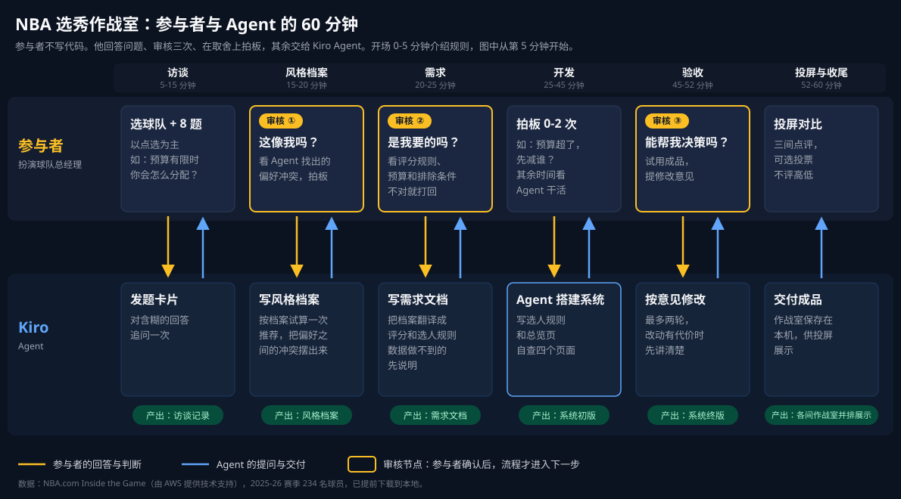

# NBA 选秀作战室（nba-draft-warroom）

这是一个 Kiro Crew skill，用于 60 分钟的 Agent 动手环节。参与者扮演一支 NBA 球队的总经理，手里有 100 点模拟薪资预算。他先回答 8 道关于用人标准的选择题，Agent 据此整理出管理风格档案，写成需求，再搭出一套按这套标准选人的网页。参与者在档案、需求、成品三处审核，全程不写代码。偏好之间有冲突时，Agent 会把冲突摆出来，由参与者决定留哪一条。

成品是一个单独的 `作战室.html`，有总览、人才库、选人台、阵容报告四个页面，按参与者的标准给全部球员排名，推荐一套 8 人阵容，并附上每个人选的理由、预算用量和阵容短板。



## 安装

仓库是私有的，用有权限的 GitHub 账号克隆到 skill 目录：

```
git clone git@github.com:walkley/NBA-Draft-War-Room.git ~/.kiro/crew/skills/nba-draft-warroom
```

更新时在该目录里运行 `git pull`。Discover 导入只能读公开仓库，仓库改回公开之前用不了。

运行要求：

- macOS。
- 能上网。头像直接从 NBA 的 CDN 加载，断网时显示灰色占位，其他功能不受影响。
- Python 3 和 Node.js。
- 建议在设置里开启 YOLO 模式，不然每一步操作都会弹出确认框。

## 准备数据

仓库自带 2025-26 赛季 234 名球员的数据（`template/data.js`），头像用 NBA CDN 的在线地址，克隆下来就能用，不用另外准备。

要换成别的数据，按下面的格式放到 `~/nba-warroom/data/`，或者放在其他目录，用环境变量 `NBA_WARROOM_DATA` 指向它。建房时会优先用这两处的数据，找不到再用仓库自带的：

```
~/nba-warroom/data/
├── data.js           球员数据
└── headshots/        可选。本地头像，文件名为 <id>.png，img 写成 headshots/<id>.png 时使用，打包时会内联进作战室，断网也能显示
```

准备好后运行校验：

```
python3 ~/.kiro/crew/skills/nba-draft-warroom/scripts/check-data.py
```

`template/data.sample.js` 是 40 名虚构球员，只在自带数据也被删掉时才会用到。

### data.js 格式

文件定义两个全局变量：

```js
window.DIMS = {"score": "得分", "create": "组织", "rebound": "篮板",
               "defense": "防守", "steady": "稳健", "gravity": "牵制"};
window.PLAYERS = [
  {"id": 2544, "n": "勒布朗·詹姆斯", "en": "LeBron James", "t": "LAL",
   "age": 41, "yr": 23, "fame": "全明星", "pts": 20.9, "reb": 6.1, "ast": 7.2,
   "c": 25, "o": 86,
   "pr": {"score": 57, "create": 94, "rebound": 79, "defense": 83, "steady": 7, "gravity": 76},
   "role": "内线进攻", "big": "季后赛下滑", "img": "https://cdn.nba.com/headshots/nba/latest/260x190/2544.png"}
];
```

`DIMS` 的六个键不能改名，界面文字可以改。

| 字段 | 含义 | 取值 | 必需 |
|---|---|---|---|
| `id` | 球员编号，唯一 | 整数 | 是 |
| `n` | 显示名 | 字符串，建议中文名 | 是 |
| `t` | 球队缩写 | 字符串 | 是 |
| `c` | 薪资（点） | 不小于 4 的整数。总预算 100 点、阵容 8 人，按这个比例设计 | 是 |
| `pr` | 六维画像 | 六个键齐全，每项 0-100 的联盟百分位 | 是 |
| `role` | 角色 | `外线持球` `外线空间` `内线进攻` `内线接应` | 是 |
| `big` | 大场面标签 | `季后赛更强` `季后赛下滑` `季后赛稳定` `未进季后赛` | 是 |
| `img` | 头像地址 | `https://...` 在线地址，或本地的 `headshots/<id>.png` | 是 |
| `en` | 英文名 | 字符串 | 否 |
| `age` | 年龄 | 整数 | 否，缺了「留年轻人」这类要求做不到 |
| `yr` | 本赛季是第几个 NBA 赛季 | 整数，1 为新秀 | 否，同上 |
| `fame` | 知名度 | `全明星` `得分前 20` 或空字符串 | 否，缺了「要球星」这类要求做不到 |
| `pts` `reb` `ast` | 场均得分、篮板、助攻 | 数字 | 否 |
| `o` | 关键时刻影响力总分的联盟百分位，可作综合参考 | 0-100 | 否 |

可选字段缺失时，Agent 会如实告诉参与者数据做不到，不会编造。

原设计中，六维画像取自 NBA.com Inside the Game 的 Leverage（得分、组织、篮板、防守、稳健五项拆分）和 Gravity 总分，换算成联盟百分位；`role` 按 Gravity 的内线/外线、有球/无球拆分归类；`big` 比较季后赛和常规赛的排名；`c` 按场均得分折算。换用其他数据源，只要满足上表的取值就行。

## 启动

在 Kiro Crew 控制台新建一个对话，发送：

```
开始选秀作战室
```

如果 Agent 没有进入流程，改发：

```
请找到 nba-draft-warroom 这个 skill，读取它的 SKILL.md，按里面的步骤开始
```

Agent 会在 `~/nba-warroom/room-<时间戳>/` 新建一间作战室，按 `SKILL.md` 的步骤往下走，最后把成品打包成 `warroom/作战室.html`，用默认浏览器打开。要在控制台的对话里启动，子代理里不会自动加载这个 skill。

## 现场使用

每位参与者一台电脑，各开一个对话。机器跑完全部步骤约 10 分钟，其余时间留给参与者看和想。

| 时间 | 环节 | 参与者要做的 |
|---|---|---|
| 0-5 分钟 | 开场 | 选一支球队 |
| 5-15 分钟 | 访谈 | 点选两张选择题卡片，每张 4 题 |
| 15-25 分钟 | 档案和需求 | 看管理风格档案像不像自己，在「可能的冲突」里做取舍，再确认需求 |
| 25-45 分钟 | 开发 | 回答 Agent 提出的 0-2 个取舍问题 |
| 45-52 分钟 | 验收 | 在浏览器里试用，提修改意见，最多两轮 |
| 52-60 分钟 | 投屏对比 | 挑三间风格反差大的作战室，把 `作战室.html` 用 AirDrop 发到投屏电脑，逐间点评 |

会前在每台电脑上试跑一次：发「开始选秀作战室」，选完球队就停，确认 `~/nba-warroom/` 下多了一个 `room-` 目录。然后删掉这个目录和试跑对话，留一个空对话给参与者。另外备一台装好的电脑，预置一间做完的作战室，开发超时就用它顶上。

每位参与者跑完一遍约需 100-150 credits。

## 常见问题

| 现象 | 处理 |
|---|---|
| 发了「开始选秀作战室」，Agent 不知道要做什么 | 改发上面那句备用的话 |
| Agent 超过 2 分钟没有反应 | 在对话里发「继续」 |
| 第 0 步报数据错误 | 不要让 Agent 改数据。重新放好 `~/nba-warroom/data/`，发「继续」让 Agent 重新建房 |
| 浏览器没有自动打开，或者页面被关掉了 | 请 Agent 再打开一次，或在 Finder 里进入 `~/nba-warroom/room-<时间戳>/warroom/`，双击 `作战室.html` |
| 点了对话里的文件链接，右侧面板一片空白 | 正常现象。右侧面板不运行页面脚本，请看浏览器里的页面 |
| 页面打开了，但没有数据 | 打开的是 `index.html`，或者改完配置后没重新打包。请 Agent 重新打包再打开 |
| 头像全是灰色方块 | 这台电脑没联网，或访问不了 `cdn.nba.com`。不影响使用，联网后刷新页面即可 |
| 有人问薪资是不是真的 | 不是。薪资按场均得分折算，用来制造预算上的取舍 |

## 已知限制

- 数据是固定的快照，不会自动更新。
- 薪资是模拟值。
- 头像依赖 NBA 的 CDN，需要联网；如果 NBA 改了地址，头像会显示成灰色占位。
- 成品只能在电脑上用浏览器打开，不能在 Kiro Crew 的右侧面板里显示，也还不能扫码在手机上打开。

## 目录

| 路径 | 内容 |
|---|---|
| `SKILL.md` | 给 Agent 的流程指令 |
| `interview.md` | 访谈题目，以及每个选项对应的配置 |
| `template/` | 作战室网页骨架、开发说明、234 名球员数据（`data.js`）、虚构示例数据 |
| `scripts/` | 建房、数据校验、试算、打包脚本 |
| `assets/` | README 用到的图 |
